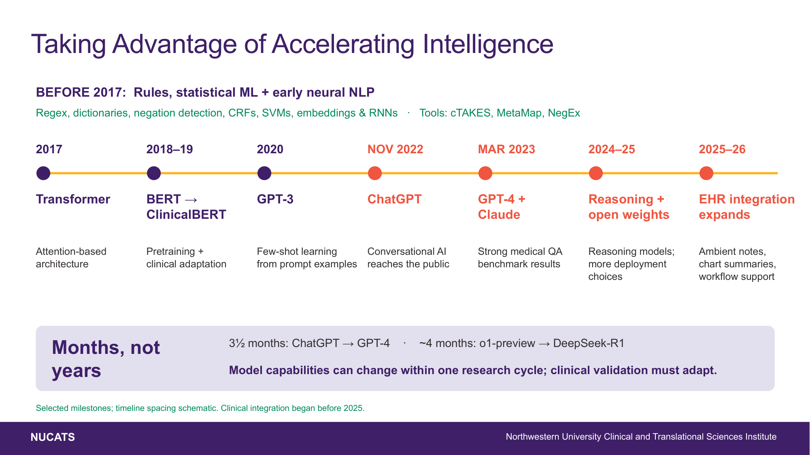
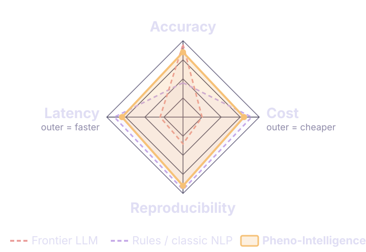
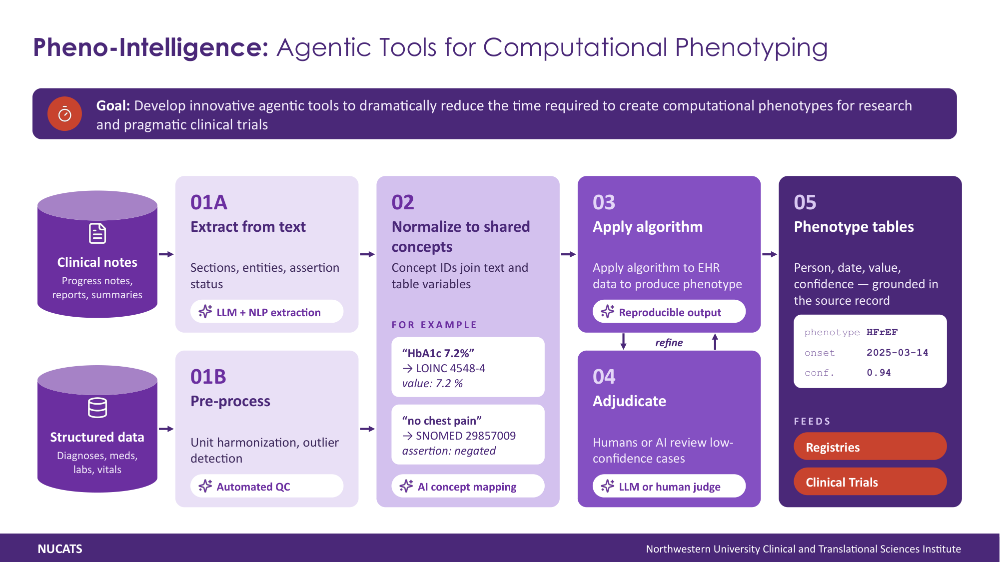
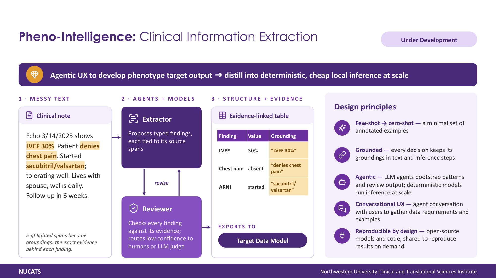
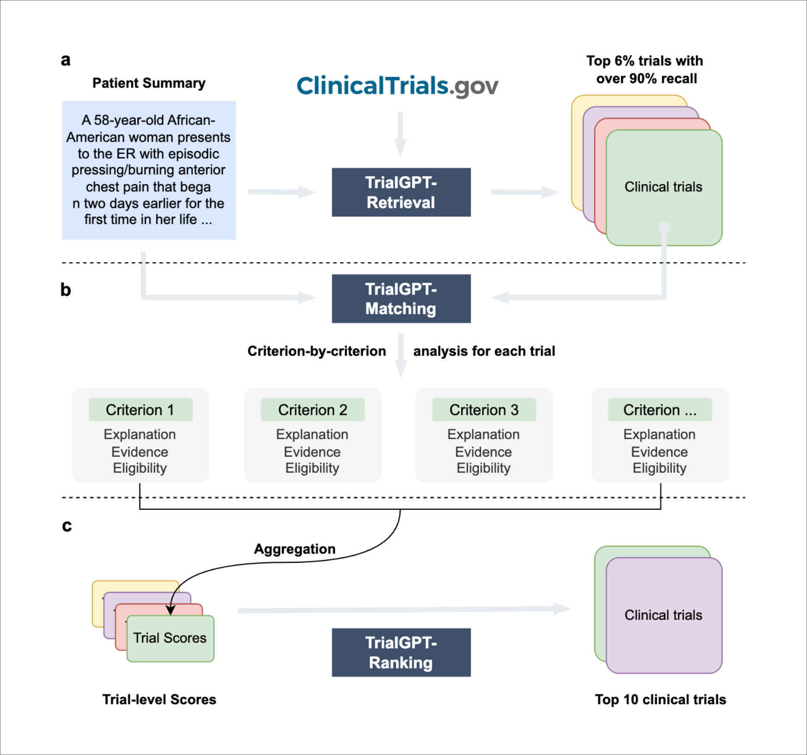
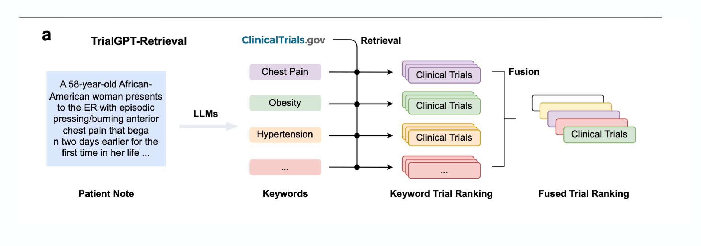
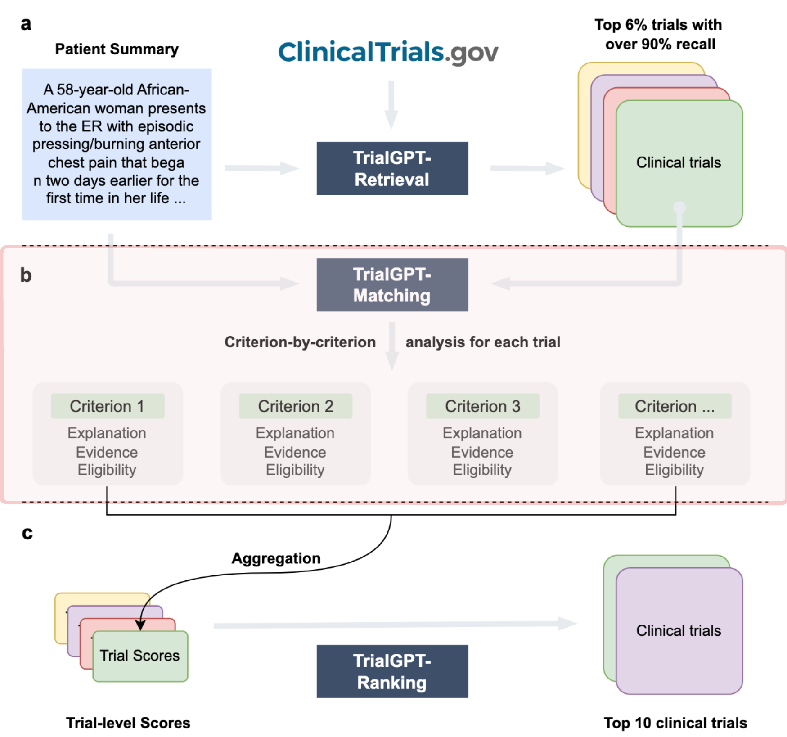
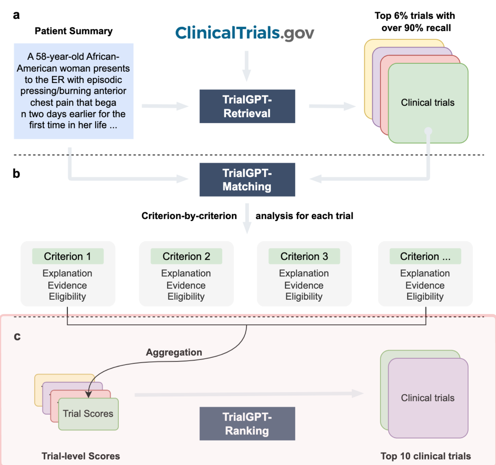

<!-- _class: lead -->
<!-- _paginate: false -->
<!-- _header: '' -->

# Pheno-Intelligence and TrialGPT

November 19, 2026

<!--
Welcome to the first meeting of the Cardiology in AI focus group.
-->

---

# Agenda

1. **Pheno-Intelligence**
2. **TrialGPT**
3. **Adaptations**

---

<!-- _class: lead -->
<!-- _header: '' -->
# Pheno-Intelligence

<!--
Opening line: the phenotypes we care about are mostly written down in prose, not
coded. Pheno-Intelligence is the framework we're building to get them out in a way
we can check.
-->

---

<!-- _header: '' -->
<!-- _paginate: false -->

---

<!-- _header: '' -->
<!-- _paginate: false -->

<!--
SLIDE MESSAGE
NLP capabilities have changed quickly since the release of ChatGPT. A clinical NLP
project may span multiple generations of foundation models. However, release cadence
and evidence for clinical safety/effectiveness are different timelines.

KEY QUALIFICATIONS
- Pre-2017 approaches included rule-based and statistical NLP alongside early neural NLP.
- GPT-3 few-shot task performance was in-context learning, without training weight updates.
- High scores on medical questions do not establish real-world clinical competence or
  readiness for autonomous care.
- 2025–26 represents expansion of EHR integration, not the first use: Microsoft and Epic
  announced integrations in 2023.
- Release timeline is selective; dates and spacing are schematic.

SOURCES
- Transformer (2017): https://arxiv.org/abs/1706.03762
- ClinicalBERT (2019): https://aclanthology.org/W19-1909/
- GPT-3 (2020): https://arxiv.org/abs/2005.14165
- ChatGPT (Nov 30, 2022): https://openai.com/index/chatgpt/
- GPT-4 (Mar 14, 2023): https://openai.com/index/gpt-4-research/
- o1-preview (Sep 12, 2024): https://openai.com/index/introducing-openai-o1-preview/
- DeepSeek-R1 (Jan 2025): https://arxiv.org/abs/2501.12948
- Epic/Microsoft EHR integration (Apr 2023): https://news.microsoft.com/source/2023/04/17/microsoft-and-epic-expand-strategic-collaboration-with-integration-of-azure-openai-service/
-->

---

# Pheno-Intelligence: Aims

1. **Inject intelligence** into phenotyping tools
2. **Optimize** for accuracy
3. **Balance** with cost, reproducibility, and latency

**Goal:** tools that let both power users and a broader community of researchers create computational phenotypes quickly, reproducibly, and at scale, without breaking the bank

<!--
The diagram is schematic, not measured. Outer edge is better on every axis (more accurate,
more reproducible, cheaper, faster). A frontier LLM run on every note is accurate but costly,
slow and hard to reproduce; rules and classic NLP are cheap, fast and reproducible but less
accurate. Pheno-Intelligence aims for the balanced shape: use agents to build the phenotype,
then distill into deterministic, cheap local inference at scale.
-->

---

<!-- _header: '' -->
<!-- _paginate: false -->

<!--
Two inputs (notes and structured data) are prepared in parallel, normalized to shared
concepts, then a versioned phenotype definition is applied. Low-confidence cases loop
through adjudication to refine the definition. Output tables carry provenance and feed
registries and pragmatic trials. Sparkle chips mark where NLP/AI shortens the timeline.
-->

---

<!-- _header: '' -->
<!-- _paginate: false -->

<!--
Pheno-Intelligence extracts structure from clinical text with every decision keeping its
evidence. An extractor proposes typed findings tied to source spans; a reviewer checks
each against its evidence and routes low-confidence cases to humans or an LLM judge. A
conversational interface gathers data requirements and examples from users up front.
The example note is illustrative, not real patient data.
-->

---

<!-- _class: lead -->
<!-- _header: '' -->

# TrialGPT

---

<!-- _header: '' -->
<!-- _paginate: false -->

<!--
TrialGPT (Jin et al., Nature Communications 2024) has three modules.
- Retrieval: an LLM generates search keywords from the patient summary and a hybrid
  BM25 + MedCPT search narrows thousands of trials to candidates.
- Matching: each inclusion and exclusion criterion gets a label, an explanation and the
  supporting sentences.
- Ranking: criterion-level judgments are aggregated into trial scores, and ineligible
  trials are excluded.
Results: 87.3% criterion-level accuracy vs 88.7–90.0% for experts; >90% recall of
relevant trials using <6% of the collection; 42.6% less screening time in a pilot user
study. Evaluated on 183 synthetic patients. The patient, trials and scores on this slide
are illustrative.
-->

---

<!-- _header: '' -->
<!-- _paginate: false -->

---

<!-- _header: '' -->
<!-- _paginate: false -->

---

<!-- _header: '' -->
<!-- _paginate: false -->

---

<!-- _header: '' -->
<!-- _paginate: false -->

---

# TrialGPT: Evaluation and Results

**Data:** 183 synthetic patients (SIGIR 2016, TREC CT 2021 and 2022), >75,000 trial annotations; GPT-4, zero-shot

| Stage | Evaluation | Result |
| --- | --- | --- |
| Retrieval | Recall of relevant trials from collections of 3.6k–26.6k | >90% recall from 5.5% of trials; LLM keywords beat raw notes and four clinicians' keywords |
| Matching | 3 physicians reviewed 1,015 patient–criterion pairs | 87.3% accuracy vs 88.7–90.0% for experts; 87.8% of explanations correct; evidence sentence F1 88.6% |
| Ranking | Top 500 retrieved trials vs NLI-model baselines | NDCG@10 0.73 vs 0.48; exclusion AUROC 0.80 vs 0.62; 43.8% better overall |
| User study | 2 physicians, 6 oncology trials × 6 vignettes | 42.6% less screening time (61.5 s → 35.3 s); accuracy 97.2% vs 91.7% (difference not significant) |

Limitations noted by the authors: short free-text summaries only (no longitudinal notes, labs or structured EHR data); trial location and recruitment status not considered; small user study; closed-source GPT-4 backbone.

<!--
Source: Jin et al., Nature Communications 2024;15:9074 (https://doi.org/10.1038/s41467-024-53081-z).
- Retrieval: GPT-4 keywords + hybrid BM25/MedCPT with reciprocal rank fusion. Recall@500 averaged 50.0% (raw note),
  83.4% (GPT-3.5), 86.2% (GPT-4). 5.5% of the collection needed for 90% recall with GPT-4, 7.0% with GPT-3.5.
- Matching: 105 patient–trial pairs from 53 SIGIR patients. Inclusion accuracy 0.899 (experts 0.876–0.916);
  exclusion 0.859. Main error types: incorrect reasoning (30.7%), ambiguous label definitions (26.9%),
  missing medical knowledge (15.4%).
- Ranking: best baseline was BioLinkBERT cross-encoder trained on MedNLI. GPT-4 feature combination:
  NDCG@10 0.7275, P@10 0.6688, AUROC 0.7979; average 0.7314 vs 0.5085.
- User study: NCI referral screening task, semi-synthetic vignettes; each pair screened once with and once without TrialGPT.
-->

---

<!-- _class: lead -->
<!-- _header: '' -->

# Adaptations

Applications to TrialGPT

---

# Retrieval

## TrialGPT

- LLM turns the patient summary into search keywords
- Hybrid BM25 + MedCPT search narrows thousands of trials to candidates

## Adaptation

- Build the query from structured data and extracted phenotypes, not just a summary
- Restrict to trials open at our sites

---

# Matching

## TrialGPT

- Each inclusion/exclusion criterion gets a label, an explanation and supporting sentences

## Adaptation

- Tie each judgment to source spans in the note, as in Pheno-Intelligence
- Send low-confidence criteria to a reviewer (human or LLM judge)

---

# Ranking

## TrialGPT

- Criterion-level judgments are aggregated into trial scores
- Ineligible trials are excluded

## Adaptation

- Show coordinators the evidence behind each score
- Use their decisions to refine definitions and scoring over time

