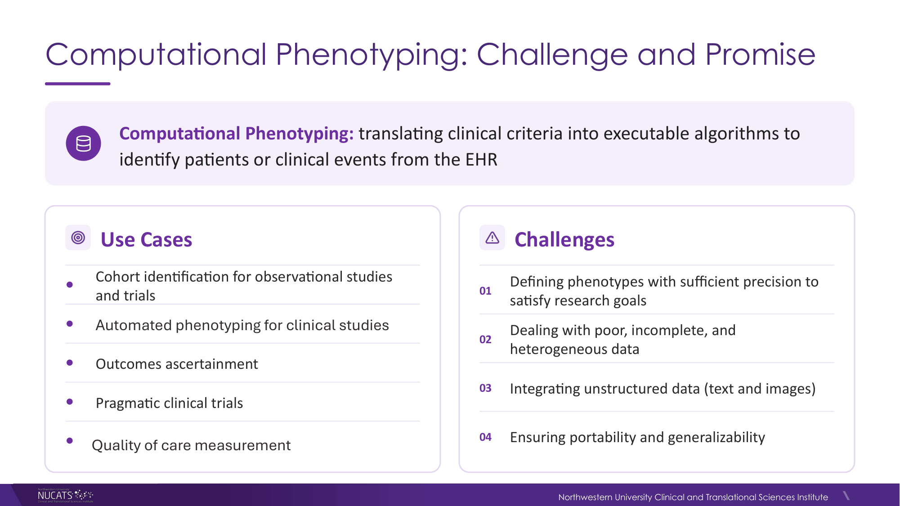
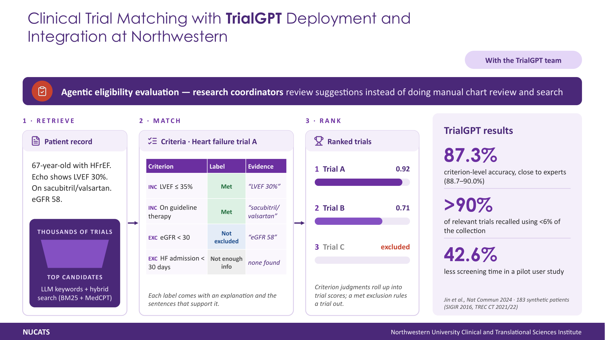
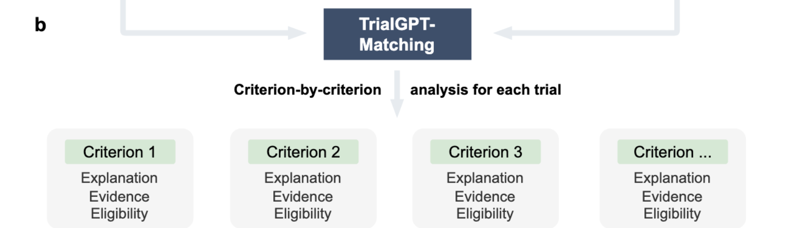
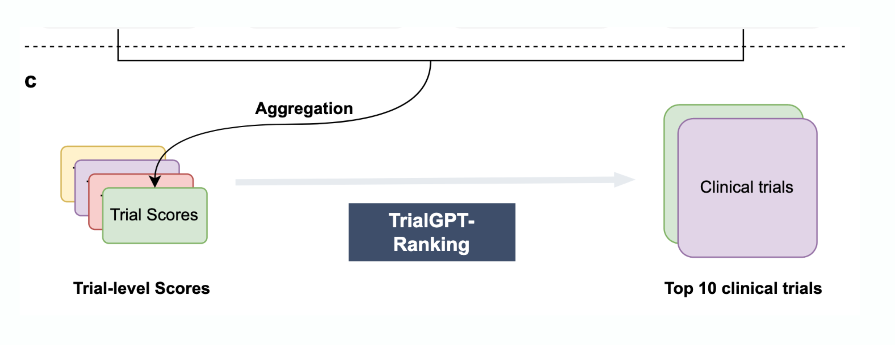

<!-- _class: lead -->
<!-- _paginate: false -->
<!-- _header: '' -->

# Pheno-Intelligence and TrialGPT

November 19, 2026

<!--
Welcome to the first meeting of the Cardiology in AI focus group.
-->

---

# Overview

1. **Pheno-Intelligence**
2. **TrialGPT**
3. **Adaptations**

---

<!-- _class: lead -->
<!-- _header: '' -->
# Pheno-Intelligence

<!--
Opening line: the phenotypes we care about are mostly written down in prose, not
coded. Pheno-Intelligence is the framework we're building to get them out in a way
we can check.
-->

---

<!-- _header: '' -->
<!-- _paginate: false -->

---

<!-- _header: '' -->
<!-- _paginate: false -->

<!--
SLIDE MESSAGE
NLP capabilities have changed quickly since the release of ChatGPT. A clinical NLP
project may span multiple generations of foundation models. However, release cadence
and evidence for clinical safety/effectiveness are different timelines.

KEY QUALIFICATIONS
- Pre-2017 approaches included rule-based and statistical NLP alongside early neural NLP.
- GPT-3 few-shot task performance was in-context learning, without training weight updates.
- High scores on medical questions do not establish real-world clinical competence or
  readiness for autonomous care.
- 2025–26 represents expansion of EHR integration, not the first use: Microsoft and Epic
  announced integrations in 2023.
- Release timeline is selective; dates and spacing are schematic.

SOURCES
- Transformer (2017): https://arxiv.org/abs/1706.03762
- ClinicalBERT (2019): https://aclanthology.org/W19-1909/
- GPT-3 (2020): https://arxiv.org/abs/2005.14165
- ChatGPT (Nov 30, 2022): https://openai.com/index/chatgpt/
- GPT-4 (Mar 14, 2023): https://openai.com/index/gpt-4-research/
- o1-preview (Sep 12, 2024): https://openai.com/index/introducing-openai-o1-preview/
- DeepSeek-R1 (Jan 2025): https://arxiv.org/abs/2501.12948
- Epic/Microsoft EHR integration (Apr 2023): https://news.microsoft.com/source/2023/04/17/microsoft-and-epic-expand-strategic-collaboration-with-integration-of-azure-openai-service/
-->

---

# Pheno-Intelligence: Aims

1. **Inject intelligence** into phenotyping tools
2. **Optimize** for accuracy
3. **Balance** with cost, reproducibility, and latency

**Goal:** tools that let both power users and a broader community of researchers create computational phenotypes quickly, reproducibly, and at scale, without breaking the bank

<!--
The diagram is schematic, not measured. Outer edge is better on every axis (more accurate,
more reproducible, cheaper, faster). A frontier LLM run on every note is accurate but costly,
slow and hard to reproduce; rules and classic NLP are cheap, fast and reproducible but less
accurate. Pheno-Intelligence aims for the balanced shape: use agents to build the phenotype,
then distill into deterministic, cheap local inference at scale.
-->

---

<!-- _header: '' -->
<!-- _paginate: false -->

<!--
Two inputs (notes and structured data) are prepared in parallel, normalized to shared
concepts, then a versioned phenotype definition is applied. Low-confidence cases loop
through adjudication to refine the definition. Output tables carry provenance and feed
registries and pragmatic trials. Sparkle chips mark where NLP/AI shortens the timeline.
-->

---

<!-- _header: '' -->
<!-- _paginate: false -->

<!--
Pheno-Intelligence extracts structure from clinical text with every decision keeping its
evidence. An extractor proposes typed findings tied to source spans; a reviewer checks
each against its evidence and routes low-confidence cases to humans or an LLM judge. A
conversational interface gathers data requirements and examples from users up front.
The example note is illustrative, not real patient data.
-->

---

<!-- _class: lead -->
<!-- _header: '' -->

# TrialGPT

---

<!-- _header: '' -->
<!-- _paginate: false -->

<!--
TrialGPT (Jin et al., Nature Communications 2024) has three modules.
- Retrieval: an LLM generates search keywords from the patient summary and a hybrid
  BM25 + MedCPT search narrows thousands of trials to candidates.
- Matching: each inclusion and exclusion criterion gets a label, an explanation and the
  supporting sentences.
- Ranking: criterion-level judgments are aggregated into trial scores, and ineligible
  trials are excluded.
Results: 87.3% criterion-level accuracy vs 88.7–90.0% for experts; >90% recall of
relevant trials using <6% of the collection; 42.6% less screening time in a pilot user
study. Evaluated on 183 synthetic patients. The patient, trials and scores on this slide
are illustrative.
-->

---

<!-- _header: '' -->
<!-- _paginate: false -->

---

<!-- _header: '' -->
<!-- _paginate: false -->

<!--
TrialGPT-Retrieval (Jin et al., Nature Communications 2024; Fig. 2a and Methods).

PURPOSE
Cut a large trial collection down to a short candidate list before the expensive
criterion-by-criterion step. Realistic search space is ~23,000 active US trials.

METHOD
1. Keyword generation: GPT-4 (or GPT-3.5) reads the free-text patient summary and
   produces up to 32 keywords (conditions, findings, etc.), ranked by importance.
   Temperature 0. Prompt in Supplementary Table 2.
2. Hybrid search per keyword: each keyword is run against two retrievers:
   - BM25: lexical / word-overlap matching
   - MedCPT: dense semantic retriever trained on PubMed search logs
3. Fusion: results are combined with reciprocal rank fusion (RRF).
   Score for trial t = sum over both retrievers and keywords i of
   1 / (i × (rank of t for keyword i + 20)).
   The 1/i factor gives higher-priority keywords more weight; C = 20 is the RRF constant.
4. Trials are ranked by this fused score; the top ones go on to Matching.

EVALUATION
- Corpus per cohort = all judged trials in that cohort (3,621 SIGIR; ~26,000 each TREC CT
  2021/2022), chosen to be close to the ~23k real-world search space.
- Compared GPT-4 keywords, GPT-3.5 keywords, the raw patient note as the query, and (SIGIR
  only) keywords written by four clinicians; each with BM25, MedCPT and hybrid retrievers.
- Metric: recall of relevant trials at different depths (eligible weighted 2,
  potential/excluded 1).

RESULTS
- Recall@500 averaged 50.0% (raw note), 83.4% (GPT-3.5), 86.2% (GPT-4).
- >=90% recall needs only 5.5% of the collection with GPT-4 (7.0% with GPT-3.5).
- MedCPT beat BM25, and the hybrid was best.
- On SIGIR, LLM keywords outperformed all four clinicians' keywords.

CAVEATS
- Pooled judgments: relevant trials outside the labeled pool count as irrelevant.
- Location and recruitment status are not considered; these would be structured filters
  in practice.
-->

---

<!-- _header: '' -->
<!-- _paginate: false -->

<!--
TrialGPT-Matching (Jin et al., Nature Communications 2024; Fig. 1b, Fig. 3 and Methods).

PURPOSE
For each candidate trial from Retrieval, judge the patient against every inclusion and
exclusion criterion, with an explanation a human can check.

METHOD
- Inputs: the patient note split into numbered sentences; the trial's background (title,
  conditions, interventions, brief summary); its inclusion and exclusion criteria.
- Two LLM calls per patient–trial pair: one for all inclusion criteria, one for all
  exclusion criteria. GPT-4, temperature 0, zero-shot. Prompts in Supplementary Tables 3–4.
- For each criterion the model outputs, in this order (chain-of-thought style):
  1. A free-text explanation of how the patient relates to the criterion
  2. The IDs of the relevant sentences in the note (the evidence)
  3. An eligibility label
- Output is JSON so it can be parsed and aggregated by Ranking.
- Label sets:
  - Inclusion: included / not included / not enough information / not applicable
  - Exclusion: excluded / not excluded / not enough information / not applicable
  Separate sets are used because exclusion criteria are phrased inconsistently
  ("Pregnancy", "should not be pregnant", "pregnant patients excluded"), which standard
  entailment labels handle poorly.

EVALUATION
- 105 patient–trial pairs from 53 SIGIR patients = 1,015 patient–criterion pairs.
- Three physicians rated each GPT-4 output: was the explanation correct, which sentences
  are relevant, and what is the right label. Consensus = majority vote (union for
  sentences); three-way disagreements on labels were discussed until agreed.

RESULTS
- Explanations: 87.8% correct, 9.7% partially correct, 2.6% incorrect. Most errors were on
  "not included" / "not excluded", which need implicit inference.
- Evidence sentences: precision 90.1%, recall 87.9%, F1 88.6% (experts 86.9–91.5%).
- Labels: overall accuracy 87.3% vs 88.7–90.0% for the experts.
  - Inclusion 89.9% (experts 87.6–91.6%)
  - Exclusion 85.9%; confused "not excluded", "not enough information" and "not applicable"
- Error analysis of 26 incorrect predictions: incorrect reasoning 30.7% (said "not enough
  information" when it could be inferred), ambiguous label definitions 26.9%, missing
  medical knowledge (synonyms, subtypes) 15.4%.

RELEVANCE TO PHENO-INTELLIGENCE
Same pattern as our extractor: each judgment is tied to source sentences, so a reviewer
can check it against the evidence.
-->

---

<!-- _header: '' -->
<!-- _paginate: false -->

<!--
TrialGPT-Ranking (Jin et al., Nature Communications 2024; Fig. 1c, Fig. 4, Table 2 and Methods).

PURPOSE
Turn the criterion-level labels from Matching into one score per trial, used for two tasks:
rank trials for a patient, and exclude trials the patient is clearly ineligible for.

METHOD
1. Linear aggregation: six simple percentages, with "not applicable" criteria removed from
   the denominator:
   - Inclusion: % included, % not included, % not enough information
   - Exclusion: % excluded, % not excluded, % not enough information
   Kept deliberately simple to probe what the LLM labels themselves carry.
2. LLM aggregation: a second GPT-4 prompt (Supplementary Table 5) reads the criterion-level
   output and returns two scores:
   - Relevance R, 0 to 100 (is the patient relevant to this trial at all?)
   - Eligibility S, from -R to +R (negative = ineligible, positive = eligible), so eligibility
     can never be stronger than relevance
3. Feature combination (final score):
   % included − [any inclusion criterion not met] − [any exclusion criterion met]
   + relevance + eligibility
   The two bracketed terms are 0/1 indicators, so a single failed criterion is a large penalty.

EVALUATION
- Top 500 trials from Retrieval for every patient in all three cohorts.
- Correlation of each score with expert trial-level labels (Fig. 4): eligible trials have
  the most criteria met; ineligible trials have the most exclusion criteria met; the LLM
  eligibility score separates eligible from excluded trials best.
- Ranking: NDCG@10 and precision@10. Excluding: AUROC for flagging ineligible trials.
- Baselines (no labeled patient–criterion data exists to train on, so all transfer from
  medical NLI datasets such as MedNLI): dual-encoders (BioBERT, PubMedBERT, SapBERT),
  cross-encoder (BioLinkBERT), encoder-decoder (SciFive). Their criterion predictions are
  aggregated the same way.

RESULTS (Table 2, averaged over the three cohorts)
- Best baseline, BioLinkBERT: NDCG@10 0.48, P@10 0.43, AUROC 0.62 (barely above random).
- GPT-4 TrialGPT, feature combination: NDCG@10 0.73, P@10 0.67, AUROC 0.80.
- Overall average 0.73 vs 0.51, i.e. 43.8% better than the best baseline.
- LLM aggregation does most of the work: eligibility score alone gives NDCG@10 0.73,
  AUROC 0.79; the best linear score (% included) gives 0.61 and 0.68.
- GPT-3.5 also beats all baselines, but by less (average 0.57).

CAVEATS
- Not directly comparable to TREC leaderboard systems: larger, more realistic corpora and
  results averaged across cohorts.
- Unlabeled patient–trial pairs are left out of the metrics.
-->

---

# TrialGPT: Evaluation and Results

**Data:** 183 synthetic patients (SIGIR 2016, TREC CT 2021 and 2022), >75,000 trial annotations; GPT-4, zero-shot

| Stage | Evaluation | Result |
| --- | --- | --- |
| Retrieval | Recall of relevant trials from collections of 3.6k–26.6k | >90% recall from 5.5% of trials; LLM keywords beat raw notes and four clinicians' keywords |
| Matching | 3 physicians reviewed 1,015 patient–criterion pairs | 87.3% accuracy vs 88.7–90.0% for experts; 87.8% of explanations correct; evidence sentence F1 88.6% |
| Ranking | Top 500 retrieved trials vs NLI-model baselines | NDCG@10 0.73 vs 0.48; exclusion AUROC 0.80 vs 0.62; 43.8% better overall |
| User study | 2 physicians, 6 oncology trials × 6 vignettes | 42.6% less screening time (61.5 s → 35.3 s); accuracy 97.2% vs 91.7% (difference not significant) |

Limitations noted by the authors: short free-text summaries only (no longitudinal notes, labs or structured EHR data); trial location and recruitment status not considered; small user study; closed-source GPT-4 backbone.

<!--
Source: Jin et al., Nature Communications 2024;15:9074 (https://doi.org/10.1038/s41467-024-53081-z).
- Retrieval: GPT-4 keywords + hybrid BM25/MedCPT with reciprocal rank fusion. Recall@500 averaged 50.0% (raw note),
  83.4% (GPT-3.5), 86.2% (GPT-4). 5.5% of the collection needed for 90% recall with GPT-4, 7.0% with GPT-3.5.
- Matching: 105 patient–trial pairs from 53 SIGIR patients. Inclusion accuracy 0.899 (experts 0.876–0.916);
  exclusion 0.859. Main error types: incorrect reasoning (30.7%), ambiguous label definitions (26.9%),
  missing medical knowledge (15.4%).
- Ranking: best baseline was BioLinkBERT cross-encoder trained on MedNLI. GPT-4 feature combination:
  NDCG@10 0.7275, P@10 0.6688, AUROC 0.7979; average 0.7314 vs 0.5085.
- User study: NCI referral screening task, semi-synthetic vignettes; each pair screened once with and once without TrialGPT.
-->

---

<!-- _class: lead -->
<!-- _header: '' -->

# Adaptations

Applications to TrialGPT

---

# Adaptations: Cheaper, Faster, More Accurate

Use clinical NLP, deterministic logic and small specialized models; save frontier LLM calls for the cases that need them

| Lever | What we could do | Main gain |
| --- | --- | --- |
| Extract once, reuse | Patient facts from clinical NLP, stored once; trial criteria parsed once, offline | Cost, reproducibility |
| Filter early | Structured pre-filters (age, sex, codes, our sites, recruiting) + a reranker: ~50 trials to matching, not 500 | Cost, latency |
| Route by difficulty | Rules → small model → frontier LLM or human only when uncertain | Cost, latency |
| Fix known errors | Ontology synonyms and subtypes, negation and temporality, explicit label rules | Accuracy |
| Learn, distill, cache | Learned ranker; distill GPT-4 labels into small open models; cache recurring criteria | Cost, reproducibility |

**Test:** how much of GPT-4 TrialGPT's accuracy can we keep at ~10% of the LLM calls, without raising false exclusions?

<!--
Source: "TrialGPT: Ideas for Cheaper, Faster, More Accurate Matching" (docs/). Facts about TrialGPT
come from Jin et al. 2024; everything else is a design hypothesis to test.

WHERE THE COST IS TODAY
TrialGPT calls an LLM to generate keywords, twice per patient–trial pair during matching (all
inclusion criteria, then all exclusion criteria), and optionally once more per pair to aggregate
scores. Ranking experiments use the top 500 trials per patient, so matching dominates:
patients × 500 trials × 2 long-context GPT-4 calls.

LEVERS
- Extract once, reuse everywhere: a patient fact store (diagnoses, meds, labs with units,
  procedures, demographics) with negation, certainty, temporality and a pointer to the source
  sentence; a trial criteria store where simple criteria become predicates (age >= 18,
  HbA1c < 9%, condition in SNOMED set) and complex ones stay as text. Missing = unknown, not negative.
- Filter early: location and recruitment status were left out of the benchmarks because
  structured queries handle them (Jin et al. p. 9). A reranker that cuts 500 to ~50 is probably
  the single biggest saving; measure recall@K of eligible trials.
- Route by difficulty: System 1 → System 2. Most criteria never reach a frontier LLM.
- Fix known errors: TrialGPT's errors were incorrect reasoning (30.7%), ambiguous labels (26.9%)
  and missing medical knowledge (15.4%) (Jin et al. p. 5).
- Learn, distill, cache: also removes dependence on closed GPT models, a limitation the authors
  list (p. 9).

EVALUATION
Ablation: swap one component at a time. Metrics: recall@K, criterion accuracy, NDCG@10, P@10,
exclusion AUROC, false-exclusion rate (the key safety metric), LLM calls, tokens, dollars,
p50/p95 latency, share of criteria resolved at each tier. Target: a cost–accuracy Pareto curve.
-->

---

# Retrieval

## TrialGPT

- LLM turns a single patient note into up to 32 search keywords
- Hybrid BM25 + MedCPT search narrows thousands of trials to candidates
- Top 500 trials per patient go on to matching

## Adaptation

- Replace the keyword LLM with clinical NLP concepts plus ontology synonyms and parents, built from re-usable extracted phenotypes and structured data
- Use a more complete patient record (multiple notes, structured data)
- Hard pre-filters first: age, sex, condition codes, recruiting, our sites
- Rerank with a specialized model (e.g. MedCPT cross-encoder, Qwen3-Reranker); send ~50 trials to matching, not 500

<!--
- Keyword queries: weight concepts by section or salience (diagnosis and chief complaint above
  incidental history).
- Pre-filters: Jin et al. (p. 9) note that geolocation and recruitment status are addressable
  with structured queries and were excluded from the benchmarks.
- Reranker: likely the single biggest cost reduction, since matching cost scales with the number
  of candidate trials. Key metric: recall@K of eligible trials after reranking.
- Qwen3 Embedding/Reranker: https://arxiv.org/abs/2506.05176
-->

---

# Matching

## TrialGPT

- Each inclusion/exclusion criterion gets a label, an explanation and supporting sentences from LLM calls
- 2 long-context GPT-4 calls per patient–trial pair

## Adaptation

- Work from structured facts grounded in source sentences, with negation and temporality, from clinical NLP
- Route each criterion by difficulty:
  - **Rules** for simple criteria (age, labs, codes, meds)
  - **Small decision model** gives the 4-way label + confidence
  - **Frontier LLM or human** only when uncertain, temporal or compound
- Send only the relevant note snippets for each criterion
- Stop as soon as a hard exclusion is confirmed
- Ontology checks for synonyms and subtypes; explicit rules for "not enough information" vs "not applicable"

<!--
- Tier 0, rules: predicate criteria evaluated against the fact store. Near-zero cost, fully auditable.
- Tier 1, decision model: fine-tuned cross-encoder or small LLM (1–8B, e.g. Qwen3 or Llama) on
  (criterion, evidence snippets). Keep TrialGPT's label sets:
  inclusion {included, not included, not enough information, not applicable},
  exclusion {excluded, not excluded, not enough information, not applicable}.
- Tier 2: frontier LLM or human reviewer for low confidence, temporal/compound criteria and known
  failure modes. Route every "not enough information" output to a second check.
- Caveat from the paper: off-the-shelf NLI models transfer poorly (best baseline NDCG@10 0.48 vs
  0.73 for GPT-4 TrialGPT), and entailment labels fit exclusion criteria badly. Tier-1 models must
  be trained on eligibility-specific labels.
- Targets TrialGPT's error types (Jin et al. p. 5): incorrect reasoning 30.7%, ambiguous label
  definitions 26.9%, missing medical knowledge 15.4%.
- Caching: memoize (patient fact, normalized criterion) results; criteria like pregnancy or
  age >= 18 recur across many trials.
-->

---

# Ranking

## TrialGPT

- Criterion-level judgments are aggregated into trial scores; ineligible trials are excluded
- Best single feature: a further LLM call that scores eligibility (NDCG@10 0.73)

## Adaptation

- Replace the LLM call with a learned **decision model** (gradient-boosted trees, LambdaMART or logistic regression)
- Features: criterion-label percentages, reranker scores, model confidence, hard-exclusion veto, share of "not enough information"
- Or a specialized reranker (e.g. Qwen3-Reranker) fine-tuned on clinical trial data
- **Open question:** can it match NDCG@10 ≈ 0.72?

<!--
- In Jin et al. (Table 2), the GPT-4 LLM-aggregated eligibility score alone reached NDCG@10
  0.7252; adding the linear features raised it only to 0.7275. Exclusion AUROC 0.7979.
- A learned ranker removes one LLM call per pair and gives calibrated, interpretable scores.
  It may lose the LLM's context-dependent weighting of criteria; that is the thing to test.
- Calibrated abstention: show uncertain criteria to recruiters rather than forcing a label. The
  authors stress experts should stay in the loop (p. 9).
- Qwen3 Embedding/Reranker: https://arxiv.org/abs/2506.05176
-->
