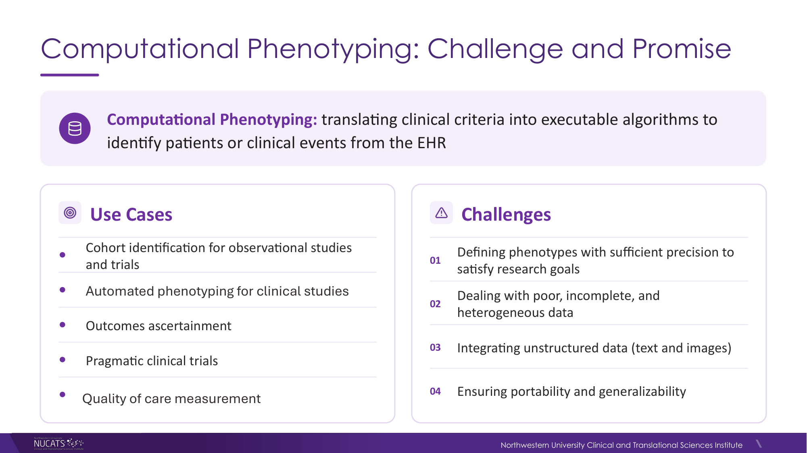
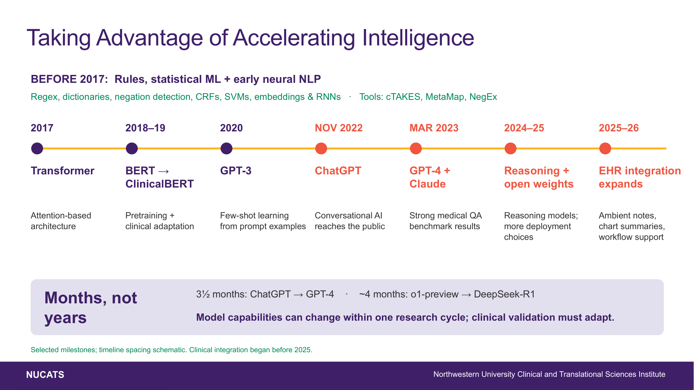
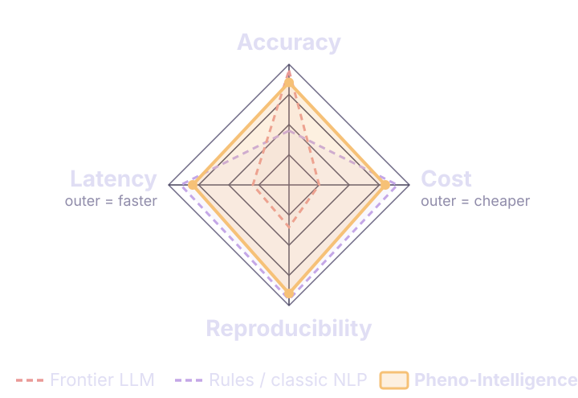
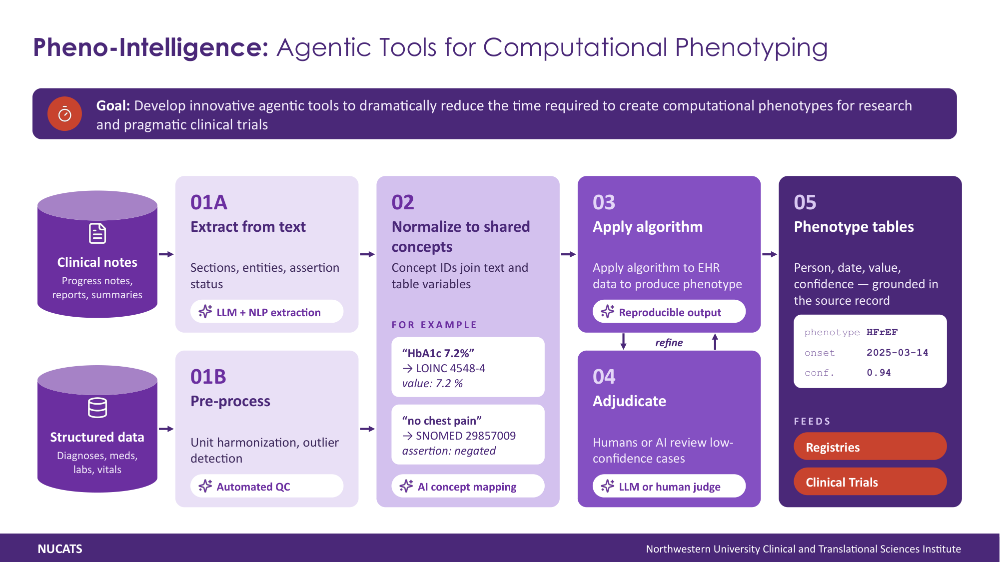
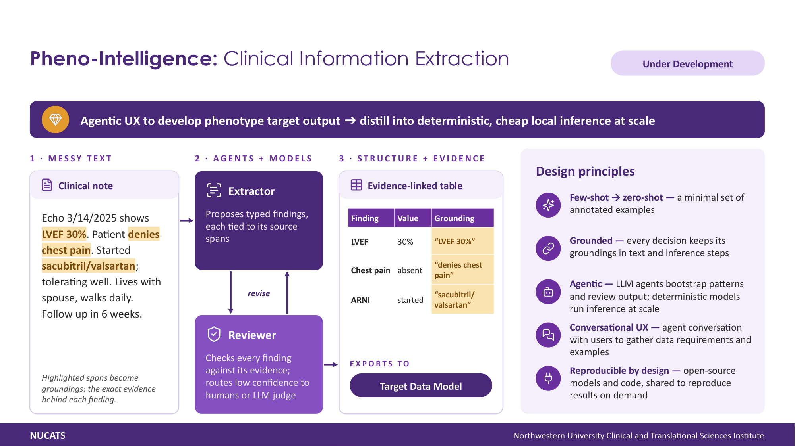
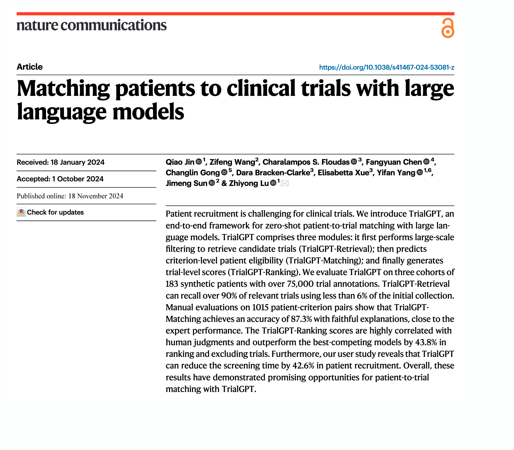
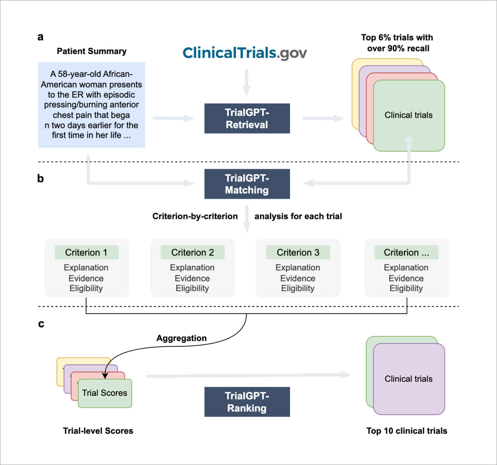
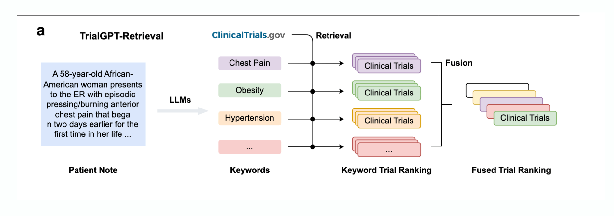
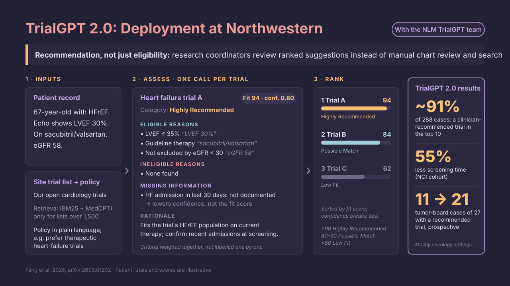

<!-- _class: lead -->
<!-- _paginate: false -->
<!-- _header: '' -->

# Pheno-Intelligence and TrialGPT

November 19, 2026

<!--
Welcome to the first meeting of the Cardiology in AI focus group.
-->

---

# Overview

1. **Pheno-Intelligence:** AI tools for building computational phenotypes
2. **TrialGPT:** LLM-based clinical trial matching, which we are deploying with the NLM team
3. **Adaptations:** eligibility criteria are phenotypes, so Pheno-Intelligence can extend TrialGPT
4. **Discussion:** questions for the group and next steps

<!--
The thread that ties the talk together: a trial's eligibility criteria are computational
phenotype definitions. Pheno-Intelligence builds phenotypes; TrialGPT matches patients to trials;
the Adaptations section shows how the first can strengthen the second.
-->

---

<!-- _class: lead -->
<!-- _header: '' -->
# Pheno-Intelligence

<!--
Opening line: the phenotypes we care about are mostly written down in prose, not
coded. Pheno-Intelligence is the framework we're building to get them out in a way
we can check.
-->

---

<!-- _header: '' -->
<!-- _paginate: false -->

---

<!-- _header: '' -->
<!-- _paginate: false -->

<!--
SLIDE MESSAGE
NLP capabilities have changed quickly since the release of ChatGPT. A clinical NLP
project may span multiple generations of foundation models. However, release cadence
and evidence for clinical safety/effectiveness are different timelines.

KEY QUALIFICATIONS
- Pre-2017 approaches included rule-based and statistical NLP alongside early neural NLP.
- GPT-3 few-shot task performance was in-context learning, without training weight updates.
- High scores on medical questions do not establish real-world clinical competence or
  readiness for autonomous care.
- 2025–26 represents expansion of EHR integration, not the first use: Microsoft and Epic
  announced integrations in 2023.
- Release timeline is selective; dates and spacing are schematic.

SOURCES
- Transformer (2017): https://arxiv.org/abs/1706.03762
- ClinicalBERT (2019): https://aclanthology.org/W19-1909/
- GPT-3 (2020): https://arxiv.org/abs/2005.14165
- ChatGPT (Nov 30, 2022): https://openai.com/index/chatgpt/
- GPT-4 (Mar 14, 2023): https://openai.com/index/gpt-4-research/
- o1-preview (Sep 12, 2024): https://openai.com/index/introducing-openai-o1-preview/
- DeepSeek-R1 (Jan 2025): https://arxiv.org/abs/2501.12948
- Epic/Microsoft EHR integration (Apr 2023): https://news.microsoft.com/source/2023/04/17/microsoft-and-epic-expand-strategic-collaboration-with-integration-of-azure-openai-service/
-->

---

# Pheno-Intelligence: Aims

1. **Inject intelligence** into phenotyping tools
2. **Optimize** for accuracy
3. **Balance** with cost, reproducibility, and latency

**Earn trust:** decisions should be transparent and explainable, so every finding stays grounded in its source evidence

**Goal:** tools that let both power users and a broader community of researchers create computational phenotypes quickly, reproducibly, and at scale, without breaking the bank

<!--
The diagram is schematic, not measured. Outer edge is better on every axis (more accurate,
more reproducible, cheaper, faster). A frontier LLM run on every note is accurate but costly,
slow and hard to reproduce; rules and classic NLP are cheap, fast and reproducible but less
accurate. Pheno-Intelligence aims for the balanced shape: use agents to build the phenotype,
then distill into deterministic, cheap local inference at scale.

Trust, transparency and explainability: clinicians and researchers will only rely on a
computational phenotype if they can see why each patient was included or excluded. That goal
drives the evidence grounding in our clinical NLP (extraction slide): every extracted finding
keeps a pointer to the exact text it came from, a reviewer checks findings against that evidence,
and low-confidence cases go to a person. It is also why the trial-matching adaptations keep
source sentences and an audit trail for each decision.
-->

---

<!-- _header: '' -->
<!-- _paginate: false -->

<!--
Two inputs (notes and structured data) are prepared in parallel, normalized to shared
concepts, then a versioned phenotype definition is applied. Low-confidence cases loop
through adjudication to refine the definition. Output tables carry provenance and feed
registries and pragmatic trials. Sparkle chips mark where NLP/AI shortens the timeline.
-->

---

<!-- _header: '' -->
<!-- _paginate: false -->

<!--
Pheno-Intelligence extracts structure from clinical text with every decision keeping its
evidence. An extractor proposes typed findings tied to source spans; a reviewer checks
each against its evidence and routes low-confidence cases to humans or an LLM judge. A
conversational interface gathers data requirements and examples from users up front.
The example note is illustrative, not real patient data.

"Deterministic models run inference at scale": the same input always gives the same output. That
includes the decision models in the Adaptations section; they return probabilities, but those
are computed, not sampled, so repeated runs agree.
-->

---

<!-- _class: lead -->
<!-- _header: '' -->

# TrialGPT

Trial matching: a use case for computational phenotypes

<!--
Bridge from the first section: matching a patient to a trial means checking the patient against
the trial's eligibility criteria, and each criterion is a small phenotype definition (e.g.
"LVEF ≤ 35% within 6 months"). We are deploying TrialGPT 2.0 at Northwestern with the NLM team.
Order of this section: the original TrialGPT (v1) and its results, what changed in v2, then what
v2 looks like in our deployment.
-->

---

<!-- _header: '' -->

# TrialGPT

An AI-powered tool for matching patients to clinical trials

- From the NLM, NIH
- Jin et al., *Nat Commun* 2024
- TrialGPT 2.0: Fang et al., 2026

[ncbi.nlm.nih.gov/research/trialgpt](https://www.ncbi.nlm.nih.gov/research/trialgpt/)

<!--
Visual introduction; talk to it.
- Developed by Zhiyong Lu's group at NLM/NIH (Division of Intramural Research).
- The original paper (Jin et al., Nature Communications 2024;15:9074): zero-shot patient-to-trial
  matching with LLMs in three modules (Retrieval, Matching, Ranking); 87.3% criterion-level
  accuracy, close to experts; 42.6% less screening time in a pilot user study.
- Project page news (as of Nov 2026): among Nature Communications' top 25 health-science papers of
  2024; featured in the journal's AI and machine learning Editors' Highlights; Dr. Lu received the
  2024 NLM Regents Award; TrialGPT 2.0 was selected for an NIH Director's Challenge Innovation Award.
- Next: the v1 design, then what changed in v2, then our deployment.
Link: https://www.ncbi.nlm.nih.gov/research/trialgpt/
-->

---

<!-- _header: '' -->
<!-- _paginate: false -->
<!-- _footer: 'Jin et al., Fig. 1 · Nat Commun 2024;15:9074 · CC BY 4.0' -->

<!--
Full TrialGPT architecture (Fig. 1): (a) Retrieval, (b) Matching, (c) Ranking. Retrieval has its
own slide next; Matching and Ranking notes are below.

TrialGPT-Matching (Jin et al., Nature Communications 2024; Fig. 1b, Fig. 3 and Methods).

PURPOSE
For each candidate trial from Retrieval, judge the patient against every inclusion and
exclusion criterion, with an explanation a human can check.

METHOD
- Inputs: the patient note split into numbered sentences; the trial's background (title,
  conditions, interventions, brief summary); its inclusion and exclusion criteria.
- Two LLM calls per patient–trial pair: one for all inclusion criteria, one for all
  exclusion criteria. GPT-4, temperature 0, zero-shot. Prompts in Supplementary Tables 3–4.
- For each criterion the model outputs, in this order (chain-of-thought style):
  1. A free-text explanation of how the patient relates to the criterion
  2. The IDs of the relevant sentences in the note (the evidence)
  3. An eligibility label
- Output is JSON so it can be parsed and aggregated by Ranking.
- Label sets:
  - Inclusion: included / not included / not enough information / not applicable
  - Exclusion: excluded / not excluded / not enough information / not applicable
  Separate sets are used because exclusion criteria are phrased inconsistently
  ("Pregnancy", "should not be pregnant", "pregnant patients excluded"), which standard
  entailment labels handle poorly.

EVALUATION
- 105 patient–trial pairs from 53 SIGIR patients = 1,015 patient–criterion pairs.
- Three physicians rated each GPT-4 output: was the explanation correct, which sentences
  are relevant, and what is the right label. Consensus = majority vote (union for
  sentences); three-way disagreements on labels were discussed until agreed.

RESULTS
- Explanations: 87.8% correct, 9.7% partially correct, 2.6% incorrect. Most errors were on
  "not included" / "not excluded", which need implicit inference.
- Evidence sentences: precision 90.1%, recall 87.9%, F1 88.6% (experts 86.9–91.5%).
- Labels: overall accuracy 87.3% vs 88.7–90.0% for the experts.
  - Inclusion 89.9% (experts 87.6–91.6%)
  - Exclusion 85.9%; confused "not excluded", "not enough information" and "not applicable"
- Error analysis of 26 incorrect predictions: incorrect reasoning 30.7% (said "not enough
  information" when it could be inferred), ambiguous label definitions 26.9%, missing
  medical knowledge (synonyms, subtypes) 15.4%.

RELEVANCE TO PHENO-INTELLIGENCE
Same pattern as our extractor: each judgment is tied to source sentences, so a reviewer
can check it against the evidence.

==========

TrialGPT-Ranking (Jin et al., Nature Communications 2024; Fig. 1c, Fig. 4, Table 2 and Methods).

PURPOSE
Turn the criterion-level labels from Matching into one score per trial, used for two tasks:
rank trials for a patient, and exclude trials the patient is clearly ineligible for.

METHOD
1. Linear aggregation: six simple percentages, with "not applicable" criteria removed from
   the denominator:
   - Inclusion: % included, % not included, % not enough information
   - Exclusion: % excluded, % not excluded, % not enough information
   Kept deliberately simple to probe what the LLM labels themselves carry.
2. LLM aggregation: a second GPT-4 prompt (Supplementary Table 5) reads the criterion-level
   output and returns two scores:
   - Relevance R, 0 to 100 (is the patient relevant to this trial at all?)
   - Eligibility S, from -R to +R (negative = ineligible, positive = eligible), so eligibility
     can never be stronger than relevance
3. Feature combination (final score):
   % included − [any inclusion criterion not met] − [any exclusion criterion met]
   + relevance + eligibility
   The two bracketed terms are 0/1 indicators, so a single failed criterion is a large penalty.

EVALUATION
- Top 500 trials from Retrieval for every patient in all three cohorts.
- Correlation of each score with expert trial-level labels (Fig. 4): eligible trials have
  the most criteria met; ineligible trials have the most exclusion criteria met; the LLM
  eligibility score separates eligible from excluded trials best.
- Ranking: NDCG@10 and precision@10. Excluding: AUROC for flagging ineligible trials.
- Baselines (no labeled patient–criterion data exists to train on, so all transfer from
  medical NLI datasets such as MedNLI): dual-encoders (BioBERT, PubMedBERT, SapBERT),
  cross-encoder (BioLinkBERT), encoder-decoder (SciFive). Their criterion predictions are
  aggregated the same way.

RESULTS (Table 2, averaged over the three cohorts)
- Best baseline, BioLinkBERT: NDCG@10 0.48, P@10 0.43, AUROC 0.62 (barely above random).
- GPT-4 TrialGPT, feature combination: NDCG@10 0.73, P@10 0.67, AUROC 0.80.
- Overall average 0.73 vs 0.51, i.e. 43.8% better than the best baseline.
- LLM aggregation does most of the work: eligibility score alone gives NDCG@10 0.73,
  AUROC 0.79; the best linear score (% included) gives 0.61 and 0.68.
- GPT-3.5 also beats all baselines, but by less (average 0.57).

CAVEATS
- Not directly comparable to TREC leaderboard systems: larger, more realistic corpora and
  results averaged across cohorts.
- Unlabeled patient–trial pairs are left out of the metrics.
-->

---

<!-- _header: '' -->
<!-- _paginate: false -->
<!-- _footer: 'Jin et al., Fig. 2a · Nat Commun 2024;15:9074 · CC BY 4.0' -->

<!--
TrialGPT-Retrieval (Jin et al., Nature Communications 2024; Fig. 2a and Methods).

PURPOSE
Cut a large trial collection down to a short candidate list before the expensive
criterion-by-criterion step. Realistic search space is ~23,000 active US trials.

METHOD
1. Keyword generation: GPT-4 (or GPT-3.5) reads the free-text patient summary and
   produces up to 32 keywords (conditions, findings, etc.), ranked by importance.
   Temperature 0. Prompt in Supplementary Table 2.
2. Hybrid search per keyword: each keyword is run against two retrievers:
   - BM25: lexical / word-overlap matching
   - MedCPT: dense semantic retriever trained on PubMed search logs
3. Fusion: results are combined with reciprocal rank fusion (RRF).
   Score for trial t = sum over both retrievers and keywords i of
   1 / (i × (rank of t for keyword i + 20)).
   The 1/i factor gives higher-priority keywords more weight; C = 20 is the RRF constant.
4. Trials are ranked by this fused score; the top ones go on to Matching.

EVALUATION
- Corpus per cohort = all judged trials in that cohort (3,621 SIGIR; ~26,000 each TREC CT
  2021/2022), chosen to be close to the ~23k real-world search space.
- Compared GPT-4 keywords, GPT-3.5 keywords, the raw patient note as the query, and (SIGIR
  only) keywords written by four clinicians; each with BM25, MedCPT and hybrid retrievers.
- Metric: recall of relevant trials at different depths (eligible weighted 2,
  potential/excluded 1).

RESULTS
- Recall@500 averaged 50.0% (raw note), 83.4% (GPT-3.5), 86.2% (GPT-4).
- >=90% recall needs only 5.5% of the collection with GPT-4 (7.0% with GPT-3.5).
- MedCPT beat BM25, and the hybrid was best.
- On SIGIR, LLM keywords outperformed all four clinicians' keywords.

CAVEATS
- Pooled judgments: relevant trials outside the labeled pool count as irrelevant.
- Location and recruitment status are not considered; these would be structured filters
  in practice.
-->

---

# TrialGPT: Evaluation and Results

**Data:** 183 synthetic patients (SIGIR 2016, TREC CT 2021 and 2022), >75,000 trial annotations; GPT-4, zero-shot

| Stage | Evaluation | Result |
| --- | --- | --- |
| Retrieval | Recall of relevant trials from collections of 3.6k–26.6k | >90% recall from 5.5% of trials; LLM keywords beat raw notes and four clinicians' keywords |
| Matching | 3 physicians reviewed 1,015 patient–criterion pairs | 87.3% criterion-level accuracy vs 88.7–90.0% for experts; 87.8% of explanations correct; evidence sentence F1 88.6% |
| Ranking | Re-ranked each patient's top 500 retrieved trials; vs NLI-model baselines | NDCG@10 0.73 vs 0.48; exclusion AUROC 0.80 vs 0.62; 43.8% better overall |
| User study | 2 physicians, 6 oncology trials × 6 vignettes | 42.6% less screening time (61.5 s → 35.3 s); accuracy 97.2% vs 91.7% (difference not significant) |

Limitations noted by the authors: short free-text summaries only (no longitudinal notes, labs or structured EHR data); trial location and recruitment status not considered; small user study; closed-source GPT-4 backbone.

<!--
Source: Jin et al., Nature Communications 2024;15:9074 (https://doi.org/10.1038/s41467-024-53081-z).
- Retrieval: GPT-4 keywords + hybrid BM25/MedCPT with reciprocal rank fusion. Recall@500 averaged 50.0% (raw note),
  83.4% (GPT-3.5), 86.2% (GPT-4). 5.5% of the collection needed for 90% recall with GPT-4, 7.0% with GPT-3.5.
- Matching: 105 patient–trial pairs from 53 SIGIR patients. Inclusion accuracy 0.899 (experts 0.876–0.916);
  exclusion 0.859. Main error types: incorrect reasoning (30.7%), ambiguous label definitions (26.9%),
  missing medical knowledge (15.4%).
- Ranking: best baseline was BioLinkBERT cross-encoder trained on MedNLI. GPT-4 feature combination:
  NDCG@10 0.7275, P@10 0.6688, AUROC 0.7979; average 0.7314 vs 0.5085.
- User study: NCI referral screening task, semi-synthetic vignettes; each pair screened once with and once without TrialGPT.
-->

---

# TrialGPT v1 → v2: What Changed

| | TrialGPT 1.0 (2024) | TrialGPT 2.0 (2026) |
| --- | --- | --- |
| Task | Is the patient eligible? | Is the trial worth pursuing for this patient now? |
| Architecture | Label each criterion, then combine | One LLM call per patient–trial pair, all criteria considered together |
| Outputs | Criterion labels; trial scores | 0–100 fit score, confidence, category, rank, structured explanation |
| Missing info | "Not enough information" label | Lowers confidence, not the fit score |
| Configurability | One general pipeline | Site-specific trial list and matching policy |
| Retrieval | Always on (BM25 + MedCPT) | Same retriever, only for lists over 1,500 trials |
| Backbone | GPT-4 | GPT-4.1 (GPT-5.4 and Gemini also tested) |
| Evaluation | Synthetic benchmarks, user study | Mostly oncology: notes from 5 sites, tumor-board study, NIH-TrialBench |
| Benchmarks | Baseline, rerun on GPT-4.1 | nDCG@10 +5.7%, P@10 +4.5%; 3.2× faster; 58–73% fewer tokens |

**The logic now lives in the LLM:** more flexible and cheaper, but no per-criterion labels to audit

<!--
Source: Fang et al. 2026, "Towards AI-Assisted Clinical Trial Matching: Practical Considerations,
Multicenter Evaluation, and ..." (docs/), summarized in "TrialGPT v1 → v2: What Changed" (docs/).

- Task: eligibility is necessary but not sufficient. Clinicians may decline a trial the patient
  qualifies for (purely diagnostic, little expected benefit over standard care, conflicts with the
  treatment plan). Labels became Recommended / Eligible but Not Recommended / Ineligible (pp. 2, 7).
- Architecture: one call per candidate trial with patient information, the trial record (metadata,
  criteria, arms) and the site's matching policy. Checks whether the patient fits any clinically
  meaningful arm; weighs formal eligibility, clinical relevance and uncertainty together; checks
  line of therapy against the trial's setting (p. 16).
- Output: eligible reasons, ineligible reasons, missing information, rationale, fit score and
  confidence. Fit score is an LLM judgment, not a formula. Categories: >90 Highly Recommended,
  80–90 Possible Match, <80 Low Fit. Ranked by fit score, confidence breaks ties (p. 16). v1's
  percentage features, indicator vetoes and separate LLM aggregation step are gone.
- Missing info: a clear violation lowers the fit score; information normally collected during
  screening lowers confidence instead (p. 16).
- Matching policy: natural-language priorities (disease or biomarker preferences, therapeutic
  trials). Meant to guide ranking, not override eligibility (pp. 2, 16).
- Retrieval: kept v1's hybrid with reciprocal rank fusion, skipped below 1,500 trials because sites
  usually review a limited local trial list (pp. 6, 16).
- Benchmarks: SIGIR and TREC 2021/2022 averages; MRR +9.8%, MAP +10.2% too; 3.2× faster, 58% fewer
  input and 73% fewer output tokens per pair (p. 13). Both versions were run on the same GPT-4.1
  backbone for this comparison (p. 25), so the backbone is not the explanation. Architecture and
  prompt changed together, so the gains can't be credited to the single-call design alone.
- Setting: four of the five retrospective sites are oncology programs (cholangiocarcinoma
  advocacy, precision-oncology tumor board, radiation oncology, NCI oncology referrals); the fifth
  is NIH Clinical Center referrals. No cardiology evaluation, which supports adapting it for us.
- Retrospective: 288 de-identified clinical-note cases (1,340 patient–trial pairs); a
  clinician-recommended trial was in the top 10 for ~91% of cases (pp. 3, 7). In the NCI cohort
  (2 clinicians, 9 candidate trials), assistance cut screening time per patient from 129.8 to 58.4
  seconds, 55% (p. 9).
- Prospective: 27 cases in the UIC precision-oncology tumor board, Feb–Jul 2026. Cases with at
  least one final clinician-selected recommendation rose from 11 to 21 (+90.9%); TrialGPT 2.0
  found 45 of the 54 final recommendations, 37 of them not found by the routine workflow (p. 9).
  Single site, small sample (authors' limitation, p. 15). Each combination of model, prompt, retrieval,
  trial list and policy is treated as a version needing local revalidation (p. 17).

TRADE-OFFS (from the summary document)
- Gains: flexibility with messy notes and unusual criteria, no curation, lower token cost.
- Losses: no per-criterion labels to audit; "preferences don't override eligibility" is an
  instruction, not a guarantee; logic checked only through outcomes; hard to add a deterministic
  layer (e.g. CTML) inside the call.
- Hybrid idea: wrap the single call with a rule/CTML pre-filter for hard criteria and a post-check
  that blocks high fit scores when a coded exclusion is met. Links to the Adaptations section.
-->

---

<!-- _header: '' -->
<!-- _paginate: false -->

<!--
What we are deploying: TrialGPT 2.0, with the NLM team and with access to the source code
(Fang et al. 2026, arXiv:2609.01202). The patient, trials and scores are illustrative.
- Inputs: the patient record, the site's own trial list, and a plain-language matching policy.
  Retrieval (BM25 + MedCPT) runs only when the list has more than 1,500 trials (Fang p. 3).
- Assess: one LLM call per patient–trial pair weighs all criteria together. Output: fit score
  (0–100), confidence, category, eligible reasons, ineligible reasons, missing information and a
  rationale. Missing information lowers confidence, not the fit score (p. 16).
- Rank: sorted by fit score, confidence breaks ties; >90 Highly Recommended, 80–90 Possible
  Match, <80 Low Fit (p. 16).
- Results (mostly oncology): a clinician-recommended trial in the top 10 for ~91% of 288
  retrospective cases (p. 7); 55% less screening time in the NCI cohort, 2 clinicians and 9
  trials (p. 9); in a 6-month prospective tumor-board study, cases with at least one recommended
  trial rose from 11 to 21 of 27 (p. 9).
This slide follows the v1 → v2 table: it shows those changes on a worked example and leads into
the Adaptations section.

Original TrialGPT (v1) summary, for reference:
TrialGPT (Jin et al., Nature Communications 2024) has three modules.
- Retrieval: an LLM generates search keywords from the patient summary and a hybrid
  BM25 + MedCPT search narrows thousands of trials to candidates.
- Matching: each inclusion and exclusion criterion gets a label, an explanation and the
  supporting sentences.
- Ranking: criterion-level judgments are aggregated into trial scores, and ineligible
  trials are excluded.
Results: 87.3% criterion-level accuracy vs 88.7–90.0% for experts; >90% recall of
relevant trials using <6% of the collection; 42.6% less screening time in a pilot user
study. Evaluated on 183 synthetic patients.
-->

---

<!-- _class: lead -->
<!-- _header: '' -->

# Adaptations

Extending TrialGPT 2.0 with Pheno-Intelligence

<!--
Arc of this section: (1) eligibility criteria are phenotypes, so trial matching is a use of
Pheno-Intelligence; (2) why we don't just adopt TrialGPT 2.0; (3) a hybrid pipeline; (4) how
trial criteria become computable; (5) how we'd evaluate it locally.
-->

---

# Eligibility Criteria Are Computational Phenotypes

| Criterion (illustrative HFrEF trial) | As a computable phenotype | Main source |
| --- | --- | --- |
| LVEF ≤ 35% within 6 months | Echo measurement, value ≤ 35, date window | Notes + structured |
| NYHA class II–IV | Extracted class, current (not historical) | Notes |
| Exclude: eGFR < 30 | Most recent lab value, with units | Structured |
| On ACEi/ARB/ARNI ≥ 3 months | Medication exposure and duration | Orders + notes |
| Exclude: life expectancy < 1 year | Clinical judgment | LLM or human |

- **Patient side** = the Pheno-Intelligence fact store; **trial side** = criteria written as phenotype definitions
- Works in both directions: **patient → trials** (TrialGPT) and **trial → patients** (cohort identification for our own trials)

<!--
The criteria are illustrative, not from a specific trial.

Key point: every row except the last is the kind of phenotype Pheno-Intelligence already extracts
(compare the extraction slide: LVEF 30%, chest pain absent, ARNI started). Trial matching then
becomes one consumer of the same facts, with the same evidence links and review loop.

Direction matters:
- Patient → trials (TrialGPT, MatchMiner patient-centric mode): a referral or clinic visit, many
  candidate trials.
- Trial → patients (MatchMiner trial-centric mode): one trial, the whole patient population. This
  is cohort identification, the first use case on our computational phenotyping slide, and likely
  the more useful product for a cardiology group running its own and pragmatic trials. Here an
  LLM call per patient–trial pair is unaffordable at population scale, so rules have to do most
  of the filtering.

Missing data: a patient with no recent eGFR is "unknown" for that criterion, not excluded.
-->

---

# Building on TrialGPT 2.0

## What v2 brings

- **Recommendation**, not just eligibility
- One overall call per pair: cheaper, faster, better benchmark results than v1
- Site-specific trial list and matching policy
- Missing information lowers confidence, not fit

## What we'd add

- **Guarantees** on hard criteria: in v2 these are instructions to the model, not rules
- **Auditable evidence** for the criteria that decide eligibility
- **Reproducibility:** versioned rules and models
- **The full record:** structured data and many notes, not one summary
- **Population scale:** trial → patients means far too many LLM calls
- **Patient data kept local**, using open models

**Approach:** deploy v2 with the NLM team, then add evidence-backed rule checks

<!--
Sources: Fang et al. 2026 (TrialGPT 2.0) and "TrialGPT v1 → v2: What Changed" (docs/).

Framing: we are deploying v2 at Northwestern with the NLM team and will have the source code, so
these are additions to v2, built and validated with its developers, not a competing system.

v2 strengths (Fang et al.):
- Clinicians may decline a trial the patient qualifies for (purely diagnostic, little expected
  benefit, conflicts with the treatment plan), so v2 predicts Recommended / Eligible but Not
  Recommended / Ineligible (pp. 2, 7).
- One call per candidate trial; 3.2× faster, 58% fewer input and 73% fewer output tokens per pair,
  and better P@10, nDCG@10, MRR and MAP than v1 on SIGIR/TREC (p. 39).
- Site trial list and a natural-language matching policy (pp. 2, 16).

What v2 gives up (from the summary document):
- No per-criterion labels to audit; "preferences don't override eligibility" is a prompt
  instruction, not a guarantee; logic can only be checked through outcomes; hard to add a
  deterministic layer inside the call.
- v2 was evaluated on clinical notes, but neither version has been tested on structured EHR data
  or longitudinal records; Jin et al. list these as future work (p. 9).
- Each combination of model, prompt, retrieval, trial list and policy is a version needing local
  revalidation (Fang p. 17). Rules and decision models with fixed, typed questions make that easier to control.
- Local open models also avoid sending patient data to an outside service, which may matter more
  for approval than cost.
-->

---

# A Hybrid Pipeline

| Stage | What runs | Gain |
| --- | --- | --- |
| 0 · Prepare once | Pheno-Intelligence facts per patient; computable criteria per trial (LLM drafts, curator checks) | Cost, reproducibility |
| 1 · Pre-filter | Rules on hard criteria + live recruiting status; missing data is "unknown", never excluded | Cost, safety |
| 2 · Assess | TrialGPT 2.0 on the short list, given facts with source sentences; a **decision model** first, v2's LLM call if unsure | Accuracy, cost |
| 3 · Guardrail | A met coded exclusion caps the fit score; low confidence goes to a coordinator | Safety, auditability |
| 4 · Review | Coordinator decisions become labels: check calibration, set thresholds, refine rules | Cost over time |

<!--
This replaces the separate Retrieval / Matching / Ranking adaptations.

Relation to the v2 deployment: stage 2 is TrialGPT 2.0 itself, with an optional decision-model
step in front of its LLM call. Stages 0, 1, 3 and 4 wrap around it. With source access, these can
be built into the deployed codebase with the NLM team and offered back upstream.

0 · Prepare once
- Patient fact store: diagnoses, meds, labs with units, procedures, demographics, each with
  negation, certainty, temporality and a pointer to the source sentence. Cache it.
- Trial criteria: hard criteria become computable definitions (next slide); free-text criteria
  stay as text for stage 2. Paid once per trial and per amendment, not per patient.

1 · Pre-filter
- Retrieval is unnecessary for a site's own trial list: v2 skips it below 1,500 trials (Fang
  p. 16). Pre-filters replace it.
- Recruiting status from our trial management system, refreshed daily, as MatchMiner does with
  OnCore; ClinicalTrials.gov status is often stale (Klein et al. 2022, pp. 3, 6).
- Only exclude on a rule that is definitely met. Missing data passes through as "unknown";
  otherwise the pre-filter becomes the main source of false exclusions.

2 · Assess
- Keep v2's overall judgment and outputs (fit score, confidence, recommended vs eligible,
  structured reasons).
- Feed it the extracted facts and the few relevant note sentences instead of the whole record:
  fewer tokens, and implicit information is made explicit. This targets TrialGPT v1's main error
  types: incorrect reasoning 30.7%, ambiguous labels 26.9%, missing medical knowledge 15.4%
  (Jin et al. p. 5); ontology synonym/subtype checks handle the last deterministically.
- Ask a decision model first (Decision Models slide); escalate to TrialGPT 2.0's LLM call when its
  probabilities are low or spread out.

3 · Guardrail
- The "hybrid idea" from the v1 → v2 summary: a post-check that blocks high fit scores when a
  coded exclusion is met, restoring a guarantee v2 lacks.
- Per-criterion evidence is kept for the criteria that decide eligibility, so a reviewer can see
  why a trial was capped or excluded.

4 · Review
- Show uncertain cases to coordinators rather than forcing a label; experts stay in the loop
  (Jin p. 9).
- Their decisions become local labels for checking decision-model calibration, setting routing
  thresholds, fine-tuning open models and refining rules, and
  corrections to trial definitions feed back to stage 0.

Ideas from the earlier draft that were dropped or folded in: the reranker (unneeded for a site
trial list), a learned ranker replacing the LLM aggregation (needs trial-level labels we don't
have, and can't capture "recommended vs eligible"), and arm-level scoring (matters mostly for
multi-arm oncology trials; can be added to the criteria format later).
-->

---

# Trial Side: Computable Criteria

## Lessons from CTML (MatchMiner)

- Nested AND/OR logic; "!" marks an exclusion
- Criteria and recruiting status per arm
- Written by hand, peer-reviewed, re-checked every 3 months
- 354 trials at Dana-Farber; matched patients consented 55 days sooner (retrospective)
- **But built for oncology:** clinical fields are only age, sex and cancer type

## For cardiology

- Write hard criteria as **OMOP cohort definitions**: concept sets, values and time windows (as in Criteria2Query)
- An LLM drafts them once per trial and per amendment; a curator checks
- Free-text criteria stay as text for the assessment step
- The same definitions double as phenotypes for registries

Example: "LVEF ≤ 35% within 6 months" → LVEF measurement concept set · value ≤ 35 · within 180 days before screening

<!--
Sources: Klein H, Mazor T, et al. MatchMiner: an open-source platform for cancer precision
medicine. npj Precision Oncology 2022;6:69. https://doi.org/10.1038/s41698-022-00312-5
Yuan C, et al. Criteria2Query: a natural language interface to clinical databases for cohort
definition. JAMIA 2019;26:294–305 (cited by Jin et al. as the "structuring" approach TrialGPT
chose not to take).

CTML / MatchMiner (Klein et al.)
- CTML: human-readable markup for trial eligibility. Nested Boolean clauses with no depth limit;
  "!" prefix marks an exclusion (p. 3).
- Five components: Trial, Treatment (arms, doses, cohorts as a tree), Match, Clinical, Genomic.
  Clinical fields: age, gender, cancer type (OncoTree) only (p. 3).
- Each arm and dose level has its own criteria and accrual status (p. 3).
- Curation: a curator adds match clauses by hand, at least one other curator peer-reviews, and all
  open trials are re-reviewed every 3 months for amendments (p. 4). MatchMinerCurate pulls basic
  trial info from ClinicalTrials.gov, but eligibility is still entered by hand (p. 3): that is the
  step an LLM draft would target.
- Results at DFCI (retrospective, 2016–2021): 354 trials; 166 consents; median time from
  sequencing report to consent 195 vs 250 days, p = 0.004 (pp. 1, 5).
- Limits: pre-screening only; not every criterion is encoded; trial readiness isn't assessed
  (pp. 2, 7). Prior therapies and labs need CTML extensions (p. 7). Clauses must match available
  data, e.g. drop an age restriction if dates of birth are missing (p. 3).

Why OMOP for cardiology
- Cardiology criteria are mostly measurements, conditions, procedures, drugs and time windows,
  which OMOP cohort definitions already express. Definitions can also be shared and reused as
  phenotypes.
- Keep CTML's good ideas: nested logic, explicit exclusions, per-arm structure where needed, and
  curator review on each amendment.
- Facts extracted from notes by Pheno-Intelligence need to land in the same concept space
  (e.g. as OMOP measurements or observations) for the definitions to run on them.

Evaluate: accuracy of LLM-drafted vs curator-written definitions, and curation time per trial.
-->

---

# Decision Models in the Pipeline

**System One decision models** answer typed questions with probabilities instead of writing text: fast, cheap and consistent

| Stage | Question for the decision model | Answer type |
| --- | --- | --- |
| 1 · Pre-filter | Is this criterion met, not met, or not documented? | Choice, with a "not documented" option |
| 2 · Assess | Recommended, eligible but not recommended, or ineligible? | Choice |
| 2 · Assess | How well does this trial fit the patient now? | Score |
| 3 · Guardrail | Does this evidence sentence support the exclusion? | Noul (probability of yes) |
| Routing | Low or spread-out probabilities → TrialGPT 2.0's LLM call or a coordinator | Rule in code |

<strong>Default: open-weight models run locally</strong> (e.g. mammoth-1, MIT licence), in line with our open-source principle; hosted services (Jev, Gemini Decision) only under a PHI agreement, as a comparison. Speed, cost and calibration figures are vendor-reported and may not carry over, so we check calibration on our data. A dedicated classifier may do as well on a narrow, well-labelled task. Explanations come from evidence sentences, or from TrialGPT 2.0 for cases shown to coordinators.

<!--
Sources (the decision-model links on the meeting page):
- TypeSafe, "Introducing System One Models & Jev" (15 Sep 2026):
  https://typesafe.ai/blog/introducing-system-one-models-and-jev
- S. Raschka, "Language Models for Text Classification: From Bag-of-Words to Jev" (29 Sep 2026):
  https://magazine.sebastianraschka.com/p/classifier-history-and-jev
- systemonemodels.org (catalogue of decision and extraction models)
- Li Q, Wang X. "Jeva: System One Models from First Principles." arXiv:2610.18773 (2026)

DEFAULT: OPEN-WEIGHT, LOCAL
- Matches the design principle on the Pheno-Intelligence extraction slide ("Reproducible by
  design: open-source models and code") and keeps patient data on our infrastructure.
- mammoth-1 (Base Labs / Baseten): 27B, MIT-licensed weights on Hugging Face, post-trained from
  Qwen3.5-27B. Cleanest licence; needs a GPU server.
- GLiDE (Fastino Labs): open-weight family from 0.4B to 27B, but under Fastino's own licence, which
  limits production use by large companies. Check whether that covers Northwestern Medicine
  before relying on it. The small sizes are attractive for running on modest hardware.
- Hosted models (Jev, Gemini Decision, Celeris) are useful as a comparison or upper bound, on
  de-identified data or under a business associate agreement.
- Vendor speed and cost figures are for hosted APIs; local cost is GPU time. Jev's calibration
  comes from TypeSafe's own training method (RLCD); open-weight models may be less well calibrated,
  so calibration is measured locally before setting routing thresholds.
- Sources for model details: systemonemodels.org (Nov 2026).

WHAT A DECISION MODEL IS
- Takes "state" (the patient facts, evidence sentences and trial criteria) and typed questions
  declared in advance; returns a probability for every allowed answer. No free text, so no
  parsing and no type errors (TypeSafe).
- Three answer types: Choice (one of a listed set), Score (position on ordered levels), Noul
  (probability that a condition holds).
- Jev (TypeSafe): trained for calibrated decisions; vendor reports 70–500 ms per call, 40–200×
  faster than frontier LLMs on its own workflow evals, input $0.042 per million tokens, output
  free. All vendor-reported; the blog itself flags possible bias in its evals.
- Typed output guarantees the format, not the truth; validate in our domain (TypeSafe docs).

WHY THEY FIT THIS PIPELINE
- Code owns the workflow; the model supplies judgments. That matches a pipeline where rules and
  thresholds are explicit and versioned (reproducibility).
- The Jeva paper argues decision models should be: null-aware (tell "no answer" apart from
  uncertainty, our "not enough information"); permutation-invariant (reordering options doesn't
  change the answer, so trial or criterion order doesn't matter); option-scalable (thousands of
  candidates, e.g. many trials); cacheable (reuse computation for recurring options, e.g. trial
  criteria prepared once). Jeva is a research architecture, not a product.
- Calibrated probabilities make the routing rule meaningful: escalate only where the model is
  unsure, and measure how many cases each tier resolves.
- Order-of-magnitude lower cost per judgment is what makes trial → patients search over a whole
  population affordable.

CAVEATS
- Raschka: Jev is "essentially a text classifier" but more general; for a narrow, well-defined
  problem a special-purpose classifier may be as good, faster and cheaper. Compare against one.
- No explanations: Celeris Decision can add a one-sentence reason; otherwise use the evidence
  sentences, or have a frontier LLM write a rationale only for the cases a coordinator reviews.
- Patient data: Jev, Gemini Decision and Celeris are hosted. GLiDE has open weights (0.4B–27B)
  under a licence that limits production use by large companies; mammoth-1 has MIT-licensed 27B
  weights (systemonemodels.org). Any hosted use needs a data agreement covering PHI.
- Decision models are new (first public release Sep 2026); none has been evaluated on clinical
  trial matching that we know of.
-->

---

# Evaluation Plan

## Data

- Past consents to our cardiology trials: was the enrolled patient–trial pair ranked highly?
- Coordinator reviews logged by the v2 deployment
- A small physician-annotated set, including "eligible but not recommended"

## Compare

- Deployed v2 (baseline) · + pre-filter and guardrail · + decision models · a dedicated classifier
- Remove one stage at a time

## Measure

- **Safety:** false-exclusion rate at the pre-filter and guardrail
- **Accuracy:** recall of enrolled pairs, precision@10, recommended vs eligible agreement
- **Cost:** LLM calls, tokens, dollars per patient screened
- **Reproducibility:** run-to-run agreement; calibration; share of decisions with evidence
- **Workload:** coordinator time per patient

**Question:** do these additions keep v2's accuracy at lower cost, with no extra false exclusions and a full audit trail?

<!--
- Past consents are the MatchMiner approach (Klein et al.): real outcomes, but retrospective and
  only positive examples; patients who were eligible but not approached look like negatives.
- The annotated set is needed for false exclusions and for "eligible but not recommended", which
  only clinicians can label (Fang et al. used Recommended / Eligible but Not Recommended /
  Ineligible).
- Fang et al. treat each combination of model, prompt, retrieval, trial list and policy as a
  separate version that needs local revalidation (p. 17); the same applies to our rules and models.
  Every change we make to the deployed v2 is a new version: agree on versioning and revalidation
  with the NLM team.
- The v2 deployment's own review interface is the natural source of ongoing coordinator labels.
- Output: a cost–accuracy curve across the compared configurations, with false exclusions held at
  or below v2's.
-->

---

# Discussion and Proposed Next Steps

## For discussion

- Which cardiology trials should we start with?
- Which direction first: patient → trials, or trial → patients?
- What data can we use: notes, structured data, OMOP?
- Who can help label "recommended" vs "eligible but not recommended"?
- Topics for the next meetings

## Proposed next steps

- Deploy TrialGPT 2.0 with the NLM team and log coordinator reviews
- Pick 2–3 cardiology trials; write their hard criteria as computable definitions
- Extract the matching patient facts with Pheno-Intelligence
- Build an evaluation set from past consents and annotated cases

<!--
Proposed, not agreed: edit before the meeting to reflect actual plans and owners.

Discussion prompts
- Trials: a small set of open cardiology trials at Northwestern, ideally with clear structured
  criteria (e.g. heart failure: LVEF, NYHA class, eGFR, medications) and a coordinator willing to
  review output.
- Direction: TrialGPT works patient → trials; finding patients for our own trials (trial →
  patients) is cohort identification and may be the more useful first product.
- Data: which notes and structured data are available, and whether the data is (or will be) in
  OMOP, which decides how the computable criteria are written.
- Labels: "recommended vs eligible" needs clinician judgment; we need volunteers for a small
  annotated set.
- Next meetings: e.g. a deeper look at TrialGPT 2.0 once deployed, decision models, or another
  phenotyping use case.
-->
